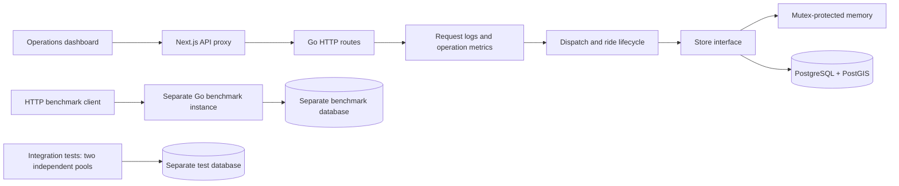
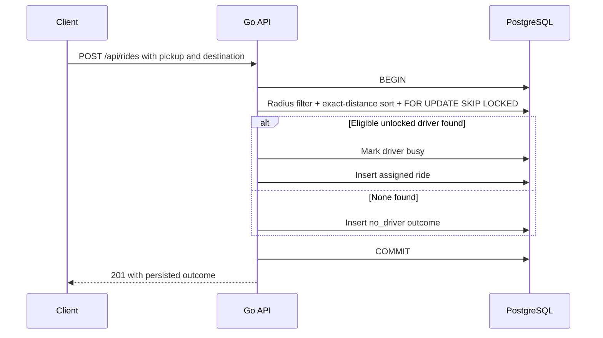

# Architecture and decisions

VYRO is a synchronous dispatch prototype with a simulated fleet, one Go service, a Next.js dashboard, and a PostgreSQL/PostGIS database. It explores concurrent resource allocation and spatial queries. It does not claim a Kafka-based distributed architecture.

## Assignment transaction

The driver row lock prevents concurrent transactions from reserving it simultaneously. `SKIP LOCKED` allows another transaction to try an unlocked candidate without waiting for that particular row. The partial unique active-ride index is a second database-level guard. Returning 201 follows transaction commit, not just in-memory selection.

Completion/cancellation first locks the ride row. Only an assigned ride can change to a terminal status. Driver release and status change commit together. A failed transaction rolls back its reservation changes. A process failure after commit but before the response reaches the client can leave an assigned ride the caller did not observe: idempotency and reservation expiry would be required to handle that robustly.

## Why these choices

| Decision | Reason | Limit |
|---|---|---|
| One Go backend | Keeps the local demonstration understandable and easy to run | No separate Java ride service or broker |
| Geography points + PostGIS | Radius checks use metres and geodesic distance | Not road routing or traffic-aware ETA |
| Radius filter then exact-distance sort | Simple ranking; avoids the observed KNN/row-locking executor issue on PostgreSQL 17.11 | Sorting many nearby candidates has a cost; only a small fleet is benchmarked |
| Row locking + unique index | Coordinates reservations across independent database pools | Skipping locked drivers may report no-driver under contention; no retry queue |
| JSONB experiment reports | Keeps structured run results without a wide summary schema | Individual requests commit separately from the report |
| Polling every two seconds | Simple observable dashboard without streaming infrastructure | No real-time push guarantees |
| Separate app, test, and benchmark databases | Reproducible experiments without consuming the dashboard fleet | All share a local PostgreSQL cluster and hardware |

## Failure behavior

- Invalid coordinates return 400; missing rides return 404; repeated terminal transitions return 409.
- Failed assignment transactions return 500. Drivers are not left reserved by a rolled-back transaction.
- Report-save failure explicitly says rides may already exist. Refresh before retrying a burst.
- A configured database failure stops startup; there is no silent fallback to memory.
- `/api/live` checks process liveness. `/api/health` checks database connectivity with a two-second deadline. `/api/ops` describes the current process; it is not a readiness verdict.
- After process restart, database rides/reports remain, while request counters, histograms, and recent latency samples reset.

## Observability

Every HTTP response gets a generated `X-Request-ID`. Mutation requests and HTTP 5xx responses produce JSON access logs containing route template, status, request ID, and duration. `VYRO_ACCESS_LOG=1` logs all requests. Coordinates, credentials, and request bodies are not included in access logs.

`/api/metrics` exposes Prometheus text counters for HTTP routes/statuses and dispatch outcomes, a successful-operation latency histogram through commit, uptime, and goroutine count. Route templates prevent ride IDs from creating unbounded metric labels. The service-pulse panel reads `/api/ops`; its p95 uses at most the latest 512 successful operation samples, including internal burst calls. Prometheus buckets accumulate successful operations since process start. Both assigned and no-driver outcomes are included.

The dashboard's ride-preparation latency, experiment operation timing, and client-measured HTTP latency are distinct measurements. See the main README and benchmark reports before comparing them.

## What the tests demonstrate

Integration tests send 50 competing dispatches through two independent connection pools, verify no duplicate reservations, check nearest-driver and radius behavior, exercise terminal transitions, and reopen storage to verify committed rides and reports. They use the separate test database. HTTP experiments then cover the direct API with real network exchanges and per-request samples.

These checks do not establish production capacity, fair scheduling, reliable client retries, multi-region behavior, or recovery from every failure. A small twelve-driver dataset also does not establish large-fleet geospatial performance.

## Next extensions, if justified

1. Idempotency keys and expiring reservations for ambiguous client retries and abandoned rides.
2. Pagination and retention for ride history and experiments.
3. Moving driver updates with timestamps and stale-location rejection.
4. A separate ride-lifecycle service and Kafka only when asynchronous delivery is part of a measured requirement.
5. Road routing, authentication, and deployment hardening before any public-facing service.
